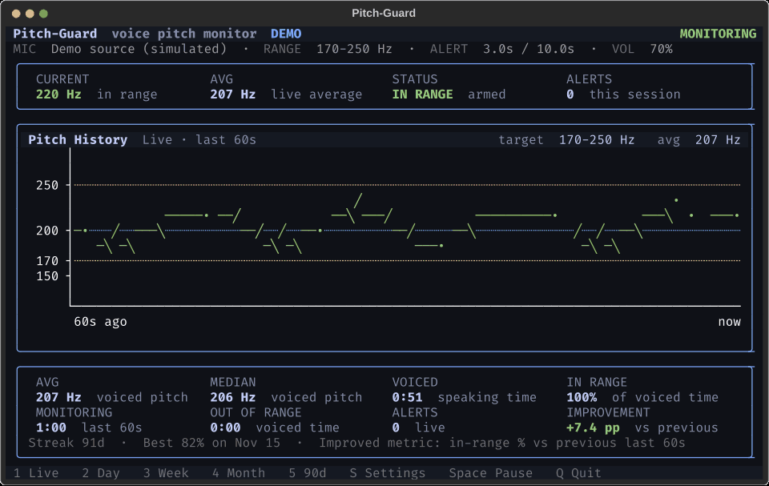

# Pitch-Guard

**Python background voice pitch tracker & notifier.**
Get a buzz when you're out of your target range.

A Python-based tool for tracking the pitch of your voice live, which notifies
you when your pitch remains outside a defined range for a certain period of
time, and shows long-term progress in a clean terminal dashboard.



The demo above is captured from the real Textual application using simulated
demo input. It is marked **DEMO** in the dashboard; demo mode never writes to
your real history.

## Features

- Starts monitoring the default microphone automatically (or a selected device).
- YIN-based fundamental-frequency (F0) estimation with silence, noise and
  unvoiced-frame rejection.
- Default target range **170–250 Hz**, inclusive.
- Presets for lower/higher voices plus a fully custom range.
- Continuous-deviation alert timer with configurable duration and cooldown.
- One short generated “bzz” per episode, with optional volume/mute.
- Live, Day, Week, Month and 90-day dotted charts with target reference lines,
  average line and silence gaps. The Live view aggregates completed one-second
  buckets and repaints only when the visible dots change, avoiding flicker.
- Time-weighted average, median, monitoring/speaking time, in-range percentage,
  alert count, previous-period improvement, daily streaks and personal bests.
- Local JSON storage only; no accounts, cloud, telemetry, or raw audio files.
- Responsive Textual dashboard with narrow-terminal numeric fallback and an
  optional ASCII rendering mode.
- Demo mode with deterministic simulated pitch and seeded history.
- Idle mode after 60 seconds without keyboard/mouse activity: audio analysis
  stops and a large “IDLE” overlay explains how to resume.
- Keyboard-first settings screen with automatic saving.

## Easy one command install (Linux, Windows, macOS)

Install [uv](https://docs.astral.sh/uv/) first, then run this from a clone of the
repository:

```bash
uv tool install --force --from . --with sounddevice pitch-guard
```

The command installs the `pitch-guard` executable and the optional audio
backend. No WSL is required on Windows. On Linux, PortAudio is a native
dependency:

```bash
# Debian / Ubuntu
sudo apt install libportaudio2

# Fedora
sudo dnf install portaudio

# Arch
sudo pacman -S portaudio
```

On macOS and Windows the `sounddevice` wheel normally includes PortAudio.

Without installing globally, you can also run it directly in the project:

```bash
uv run --extra audio pitch-guard
```

### Install uv

- **Linux / macOS:** `curl -LsSf https://astral.sh/uv/install.sh | sh`
- **Windows PowerShell:** `powershell -c "irm https://astral.sh/uv/install.ps1 | iex"`
- **Windows:** `winget install --id=astral-sh.uv -e`
- **macOS:** `brew install uv`

## Usage

```bash
pitch-guard                 # monitor the default microphone
pitch-guard --demo          # simulated input + seeded demo history
pitch-guard --demo --mute   # silent demo (useful for screenshots)
pitch-guard --ascii         # force ASCII borders and chart glyphs
pitch-guard --mic "USB Microphone"
pitch-guard --data-dir ./test-data
pitch-guard --log-level DEBUG
pitch-guard --version
```

For a clean process/tmux name, use the installed command rather than `uv run`:

```bash
pitch-guard
```

`uv run` is a supervisor process and will remain named `uv` in tmux/process
lists. The installed command sets its OS process title to `pitch-guard`, so tmux,
`ps`, and `top` show `pitch-guard`.

On launch, the dashboard starts monitoring immediately. Press `Space` to pause,
`S` for settings, number keys to switch the chart period, and `Q` or `Ctrl+C` to
quit cleanly.

If there is no keyboard or mouse activity for one minute, Pitch-Guard enters
**IDLE** mode: microphone analysis stops, the statistics panel is hidden, and a
large centered overlay appears over the chart. Press any key or move the mouse to
resume. A manual pause is never overwritten by idle mode. Settings are applied immediately and saved atomically; monitoring
and statistics stop before the process exits.

### Demo mode

`--demo` never touches a microphone and never persists to your real data
directory. It uses a repeating 60-second speech-like trace and seeded
statistics for the chart periods, so the interface can be demonstrated and
tested without audio hardware. A `DEMO` badge is always visible.

## Configuration

Open settings with `S`. The interactive screen provides:

| Setting            | Default        | Notes                                                  |
| ------------------ | -------------- | ------------------------------------------------------ |
| Pitch range preset | Default        | Default 170–250, Lower 100–180, Higher 220–330, Custom |
| Minimum pitch      | 170 Hz         | 50–600 Hz; must be below maximum                       |
| Maximum pitch      | 250 Hz         | 50–600 Hz; must be above minimum                       |
| Alert duration     | 3.0 s          | 0.5–60 s of one continuous out-of-range episode        |
| Alert cooldown     | 10.0 s         | 0–600 s before the timer can re-arm                    |
| Microphone         | System default | Device name; falls back safely if disconnected         |
| Alert volume       | 70             | 0–100; 0 mutes the generated buzz                      |

All settings are validated and saved automatically to
`~/.pitch-guard/config.json`. Invalid values are rejected in the settings screen
and never overwrite the last valid configuration. Override the data directory
with `--data-dir` or `PITCH_GUARD_HOME`; useful for testing and demo automation.

Settings also provides two diagnostics:

- **Use voice** samples the last few seconds of voiced speech and sets a custom
  target range around your current median pitch (roughly ±18%).
- **Test buzz** plays the alert at the current volume without changing settings.

### Alert timing behavior

The buzz only plays after **one continuous out-of-range episode** lasting at
least the configured duration:

- 1 second out of range, then back in range: no alert.
- 2.9 seconds out of range: no alert with a 3-second threshold.
- 3 continuous seconds out of range: one buzz.
- Any in-range pitch frame resets the timer.
- Brief unvoiced consonants and pauses up to 0.75 seconds are bridged so natural
  speech still alerts; the gap itself never counts toward the threshold.
- Any in-range pitch, or a silence/unvoiced gap longer than 0.75 seconds, resets
  the timer. Silence never counts toward the threshold.
- Below-minimum and above-maximum pitch use the same behavior.
- The same episode never buzzes repeatedly. After a buzz the tracker disarms and
  re-arms only after voiced pitch returns in range **and** the cooldown elapses.

Timing uses a monotonic clock, so system clock changes cannot affect alert
duration.

## Keyboard Shortcuts

| Key                 | Action                              |
| ------------------- | ----------------------------------- |
| `1`                 | Live chart — last 60 seconds        |
| `2`                 | Day chart — today                   |
| `3`                 | Week chart — last 7 days            |
| `4`                 | Month chart — last 30 days          |
| `5`                 | 90-day chart — last 90 days         |
| `S`                 | Open settings                       |
| `Space`             | Pause / resume monitoring           |
| `Tab` / `Shift+Tab` | Move focus between controls         |
| Arrow keys          | Navigate menus and settings choices |
| `Enter`             | Select / confirm                    |
| `Esc`               | Return to the dashboard             |
| `Q`                 | Quit cleanly                        |
| `Ctrl+C`            | Quit cleanly                        |

The dashboard footer shows the compact set of shortcuts. Numeric, `S` and
`Space` shortcuts do not fire while an input field is being edited.

## Statistics and Improvement Tracking

The selected period drives both the chart and the statistics panel:

- **Average / median voiced pitch** — time-weighted over voiced speech only.
- **Monitoring time** — time the app was actively monitoring.
- **Voiced speaking time** — reliable voiced frames only.
- **In-range / out-of-range time** — voiced time inside or outside the target
  range.
- **In-range percentage** — `in_range / voiced_time`, excluding silence.
- **Alerts** — buzzes recorded in the period.
- **Improvement** — percentage-point change in in-range percentage versus the
  previous equivalent period. Higher in-range compliance is improvement; the app
  does not assume that higher or lower pitch is inherently better.
- **Daily streak** — consecutive days with at least one minute of voiced speech.
- **Personal best** — the highest daily in-range percentage among days with at
  least one minute of voiced speech.

For Day, the previous comparison is yesterday up to the same clock time. For
rolling periods (Week/Month/90 Days), it is the immediately preceding equal
length window. Live compares the last 60 seconds with the preceding 60 seconds.
Insufficient data is shown as `N/A` rather than fabricated zeros.

Historical in-range totals are recorded with the thresholds active at capture
time. Changing the target range later does not retroactively rewrite past
compliance, although the chart’s current reference lines show the new range.

### Local JSON storage

Everything lives under `~/.pitch-guard/`:

```text
~/.pitch-guard/
├── config.json        # validated settings and schema version
├── history.json       # aggregated time buckets and pitch histograms
├── daily-stats.json   # cached daily rollups for streaks/personal bests
└── pitch-guard.log    # rotating diagnostics; never raw audio
```

- JSON only; no database, accounts, cloud sync, or telemetry.
- Writes are atomic (temporary file + `fsync` + replace).
- Timestamps are stored as timezone-safe UTC ISO-8601 strings.
- Malformed files are copied to `<name>.corrupt` and repaired gracefully.
- Recent measurements use 5-minute buckets; buckets older than 24 hours are
  compacted into hourly buckets.
- Data is retained for 180 days so the 90-day view can be compared with the
  preceding 90 days. No raw microphone audio is ever stored.
- File growth is bounded by compaction and retention.

## Development

### Requirements

- Python 3.11 or newer.
- [uv](https://docs.astral.sh/uv/) for environments, dependencies and tooling.
- A microphone and working audio backend for real-input testing.
- Linux native PortAudio package (see installation above).
- Optional, for regenerating the demo asset: Pillow (dev dependency) plus
  `rsvg-convert` (librsvg) or ImageMagick.

### Setup

```bash
cd pitch-guard
uv sync --all-extras --dev
uv run pre-commit install --install-hooks
```

Run from the checkout:

```bash
uv run --extra audio pitch-guard
uv run --extra audio pitch-guard --demo
```

The developer’s `~/maya-nvim` configuration uses **Ruff** for formatting and
linting, and **ty** for Python type checking. Pitch-Guard reuses those tools and
keeps their configuration in `pyproject.toml`, so they work without Neovim:

```bash
uv run ruff format --check .
uv run ruff check .
uv run ty check
```

### Testing and Code Quality

```bash
uv run pytest
uv run pytest --cov=pitch_guard
```

The test suite uses deterministic synthetic audio, bounded fake sources and a
recording buzzer. It covers pitch detection, silence/noise rejection, continuous
alert timing, timer resets, cooldown/re-arm, pause/resume, statistics,
period aggregation, improvement, JSON persistence/error recovery, configuration
validation, keyboard navigation, narrow/ASCII rendering and clean shutdown.

Pre-commit hooks:

- `ruff format` and `ruff check --fix` on staged Python files.
- `ty check` before commit.
- Full `pytest` suite before push.

Regenerate the README demo GIF from the real app:

```bash
uv run python scripts/capture_demo.py
```

### Project layout

```text
src/pitch_guard/
├── audio/          # microphone, YIN pitch detection, demo input, playback
├── ui/             # Textual app, settings modal, chart widget, styles
├── aggregation.py  # buckets, histograms, compaction, daily rollups
├── alert.py        # continuous out-of-range timer state machine
├── stats.py        # live/period statistics and improvement
├── storage.py      # atomic JSON, paths, timestamps
├── persistence.py  # config/history/daily file orchestration
├── service.py      # application service and lifecycle
└── cli.py          # pitch-guard command

tests/              # mirrors the package structure
docs/               # architecture, troubleshooting, demo GIF
scripts/            # reproducible demo capture
```

See [docs/architecture.md](docs/architecture.md) for the data flow, storage
schema and alert state machine, and
[docs/troubleshooting.md](docs/troubleshooting.md) for audio, permission,
rendering and platform guidance.

## Platform support

The application uses only Python, Textual, NumPy and the cross-platform
`sounddevice`/PortAudio backend. It does not require WSL, a GUI toolkit, Nerd
Fonts, or terminal image protocols. Windows `cmd.exe`, PowerShell, Windows
Terminal, macOS Terminal/iTerm2 and Linux terminals are supported by the code
paths and fonts used; narrower terminals automatically receive a numeric chart
fallback.

**Tested here:** Fedora Linux with a UTF-8 terminal, headless Textual rendering,
demo mode, and the automated test suite. Real microphone capture could not be
tested in this environment because PortAudio was not installed and no input
device was exposed; that failure path is handled and logged. macOS and Windows
were not available for execution testing, so they are documented as supported
targets rather than claimed-tested platforms.

## License

MIT. See [LICENSE](LICENSE).
