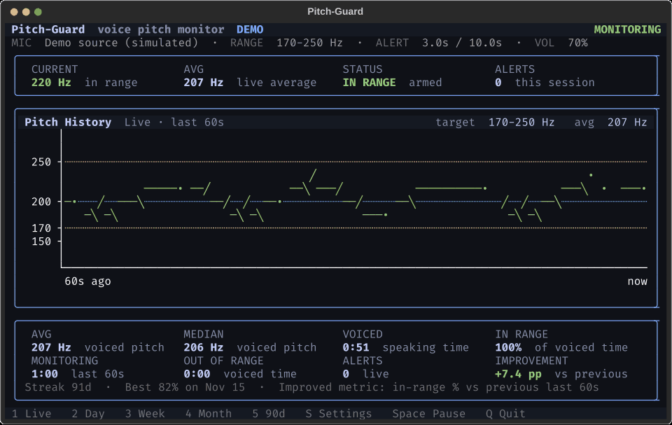

# Pitch-Guard — Implementation Requirements

Build **Pitch-Guard**, a lightweight, cross-platform Python application that monitors voice pitch in real time, alerts users when their pitch remains consistently outside a configurable range, and tracks long-term progress.

Prioritize reliability, simplicity, low resource consumption, polished terminal UI, and native compatibility with Linux, Windows, and macOS.

## 1. Core functionality

- Automatically start monitoring the default microphone when the application launches.
- Continuously estimate fundamental voice frequency (F0) in Hz.
- Ignore silence, background noise, unvoiced audio, and unreliable pitch measurements.
- Display current pitch and average voiced pitch.
- Default target pitch range: **170–250 Hz**, inclusive.
- Provide configurable pitch range presets, including the default range and a custom range.
- Allow configuration of minimum/maximum pitch, alert duration, alert cooldown, and microphone device.
- Play a short, recognizable **"bzz" sound** when pitch remains continuously outside the configured range for the required duration.
- Continue monitoring until the application exits or monitoring is paused.
- Never record or persist raw microphone audio.

### Alert timing — critical behavior

The notification must only play after **one continuous out-of-range episode** lasting at least the configured duration.

For example, with a 3-second threshold:

- Outside range for 1 second, then inside: no alert.
- Outside range for 2.9 seconds: no alert.
- Continuously outside range for 3 seconds: play one buzz.
- Returning inside range before the threshold resets the timer.
- Silence, unvoiced input, or unreliable pitch detection interrupts and resets the timer.
- Do not accumulate separate short deviations into one alert.
- Do not repeatedly buzz during the same continuous out-of-range episode.
- Re-arm after the pitch reliably returns inside range, respecting the configured cooldown.
- Both below-minimum and above-maximum pitch must trigger the same alert behavior.

Use a monotonic clock for timing and tolerate only brief audio-processing jitter, without counting actual silence or valid in-range pitch toward the threshold.

Test these conditions thoroughly.

## 2. Terminal UI

Use **Textual** for the application interface.

Create a polished, minimal, modern-classic terminal dashboard that looks good in a normal terminal, without becoming visually excessive.

### Visual design

- Use clean Unicode box-drawing borders where terminal support allows.
- Prefer thin lines, subtle dividers, balanced spacing, and clearly separated panels.
- Use rounded borders sparingly, if appropriate.
- Use a restrained color palette and a consistent dark-theme appearance.
- Prefer simple, elegant line charts over complicated terminal graphics.
- Avoid emoji, Nerd Fonts, decorative icons, excessive colors, large ASCII art, gradients, and unnecessary animations.
- Use Textual's built-in styling and layout capabilities wherever possible.
- Ensure the interface is readable in monochrome terminals.
- Adapt to narrow terminal windows and different font sizes.
- Do not force ASCII-only rendering when Unicode borders render correctly.
- Gracefully fall back to basic ASCII borders and charts when terminal capabilities are limited.
- Avoid unnecessary custom widgets or rendering implementations when established Textual functionality suffices.
- Keep the UI responsive, including while microphone capture and statistics processing are active.
- Short UI where makes sense, e.g. Average ... => AVG ... Don't make it boring or clunky.

The desired appearance is closer to a clean terminal system monitor than a retro ASCII-art application.

### Dashboard

Display:

- Application title and monitoring status.
- Active microphone.
- Current pitch in Hz.
- Average pitch in Hz.
- Configured pitch range.
- Current pitch status: in range, out of range, silence, or paused.
- A switchable pitch history chart.
- Summary statistics for the selected period.
- Improvement compared with the previous equivalent period.
- Compact keyboard shortcut footer.

### Settings

Provide an interactive settings screen for:

- Pitch range preset selection.
- Custom minimum and maximum pitch.
- Duration required before an alert.
- Alert cooldown.
- Microphone selection.
- Alert volume, where supported.

Persist settings automatically.

## 3. Pitch chart and period selection

Use one primary pitch chart with five selectable periods:

| Key | Period  | Display         |
| --- | ------- | --------------- |
| `1` | Live    | Last 60 seconds |
| `2` | Day     | Today           |
| `3` | Week    | Last 7 days     |
| `4` | Month   | Last 30 days    |
| `5` | 90 Days | Last 90 days    |

Requirements:

- Display a clean line chart with readable axes and labels.
- Show the configured minimum and maximum pitch thresholds as horizontal reference lines.
- Show the average pitch for the selected period.
- Automatically update chart data when switching periods.
- Update the Live view continuously without flickering.
- Aggregate historical measurements appropriately for different time scales.
- Represent missing measurements and silence as gaps rather than zero Hz.
- Avoid connecting unrelated measurements across long silent intervals.
- Make chart rendering efficient and responsive.
- Use an existing Textual-compatible plotting library if it works reliably across supported terminals; otherwise implement a small, maintainable chart widget.
- Provide a simplified numeric fallback for terminals too narrow to show a useful chart.

## 4. Statistics and improvement tracking

Track and display statistics for the selected period:

- Average voiced pitch (Hz).
- Median voiced pitch (Hz).
- Total monitoring duration.
- Total voiced speaking duration.
- Time within the target pitch range.
- Time outside the target pitch range.
- Percentage of voiced time within range.
- Number of alerts.
- Improvement compared with the previous equivalent period.
- Daily streaks and personal bests where meaningful.

### Improvement calculation

Use **percentage of voiced speaking time within the configured target range** as the primary improvement metric.

- Compare against the previous equivalent period.
- Show percentage-point changes.
- Do not assume higher or lower pitch inherently means improvement.
- Exclude silence from pitch averages and range-compliance percentages.
- Preserve historical threshold settings to avoid invalidating previous statistics when users change their target range.
- Do not fabricate statistics when insufficient data exists; display `N/A`.
- Use accurate time-weighted aggregations for historical measurements.

## 5. Local JSON storage

Store application configuration and historical statistics under:

`~/.pitch-guard/`

Suggested structure:

```text
~/.pitch-guard/
├── config.json
├── history.json
└── daily-stats.json
```

Requirements:

- Persist configuration and statistics between launches.
- Use JSON only; no database.
- Store aggregated pitch measurements rather than every raw audio frame.
- Retain sufficient data for historical charts and comparisons.
- Prevent unbounded file growth.
- Use atomic writes and schema versioning.
- Handle missing, malformed, and outdated JSON files gracefully.
- Store timestamps in a timezone-safe format.
- Never store raw microphone recordings.
- No accounts, cloud dependencies, or telemetry.

## 6. Keyboard navigation

Support:

- `1` — Live chart.
- `2` — Day.
- `3` — Week.
- `4` — Month.
- `5` — 90 Days.
- `S` — Settings.
- `Space` — Pause/resume monitoring.
- `Tab` / `Shift+Tab` — Navigate controls.
- Arrow keys — Navigate menus and settings.
- `Enter` — Select or confirm.
- `Esc` — Return to dashboard.
- `Q` — Quit cleanly.

Show relevant shortcuts in the footer.

Ensure keyboard shortcuts do not interfere with editing settings fields.

## 7. Cross-platform compatibility

Support native execution on:

- Linux terminals.
- macOS Terminal and iTerm2.
- Windows 10/11 Command Prompt (`cmd.exe`).
- Windows PowerShell.
- Windows Terminal.

Requirements:

- No WSL requirement.
- No platform-specific GUI dependencies.
- No reliance on Nerd Fonts or external terminal graphics protocols.
- Detect terminal capabilities and provide reasonable rendering fallbacks.
- Use cross-platform microphone capture and sound playback libraries.
- Handle microphone permissions and unavailable audio devices gracefully.
- Avoid shell-specific application logic.
- Support graceful interruption and shutdown.
- Test Windows CMD compatibility explicitly where possible.
- Document any environments that could not be tested instead of claiming unverified compatibility.

## 8. Architecture

Keep components modular and independently testable:

- Microphone capture.
- Pitch detection.
- Alert timing and sound playback.
- Statistics collection.
- Historical aggregation.
- JSON storage.
- Configuration management.
- Textual interface.

Requirements:

- Never block the TUI event loop with microphone processing.
- Use bounded, thread-safe communication between audio processing and the UI.
- Minimize CPU and memory usage.
- Use a monotonic clock for alert timing.
- Handle clean application shutdown.
- Avoid overengineering and unnecessary dependencies.
- Prefer clear, strictly typed Python code.

## 9. Development environment

Use **uv** for dependency management, virtual environments, running, and development.

Expose the application as:

```bash
pitch-guard
```

Provide a straightforward, preferably one-command installation method for Linux, Windows, and macOS.

### Developer tooling

Inspect the developer's `~/maya-nvim` configuration.

Identify the Python:

- Type checker.
- Linter.
- Formatter.
- Relevant configuration and settings.

Reuse these tools and equivalent settings in the project.

- Persist configurations in `pyproject.toml` or appropriate dedicated files.
- Ensure the tooling works without the developer's Neovim configuration.
- Add pre-commit hooks for formatting, linting, and type checking.
- Run these tools explicitly during task finalization.
- Fix detected issues rather than unnecessarily suppressing diagnostics.
- If `~/maya-nvim` is unavailable, document that limitation and use sensible modern Python tooling defaults.

## 10. Testing

Add automated tests covering:

- Pitch detection and classification.
- Silence and unreliable audio handling.
- Continuous out-of-range alert timing.
- Timer resets and brief interruptions.
- Alert cooldown and re-arming.
- Pause/resume behavior.
- Statistics calculations.
- Historical period aggregation.
- Improvement tracking.
- JSON persistence and error recovery.
- Configuration validation.
- Keyboard navigation.
- Clean application shutdown.

Mock audio input and playback for deterministic tests.

Provide a demo mode with simulated pitch measurements so the interface can be demonstrated and tested without a microphone.

## 11. README and documentation

**Updating and completing `README.md` is explicitly part of the implementation scope.**

Inspect the existing README before editing it. Preserve its identity, description, and useful existing content.

Fill out missing sections, incomplete TODO placeholders, and unfinished setup instructions with accurate documentation matching the actual implementation.

Use the following structure:

```markdown
# Pitch-Guard

**Python Background Voice Pitch Tracker.**

A Python-based tool for tracking the pitch of your
voice live, which notifies you when your pitch
remains outside a defined range for a certain
period of time.



## Features

...

## Easy one command install (Linux, Windows, macOS)

...

## Usage

...

## Configuration

...

## Keyboard Shortcuts

...

## Statistics and Improvement Tracking

...

## Development

### Requirements

...

### Setup

...

### Testing and Code Quality

...
```

### README demo image — required

Create and include a real visual demonstration of the application near the very beginning of the README.

Requirements:

- Prefer an animated `docs/demo.gif` showing the actual TUI.
- Alternatively, include a high-quality `docs/demo.png` screenshot if GIF generation is impractical.
- Capture the actual running application, not a separately designed mockup.
- Use simulated pitch input through the application's demo mode for reproducible screenshots.
- Show the dashboard, current/average pitch, target range, chart, and statistics.
- For GIFs, demonstrate switching chart periods and updating pitch measurements.
- Use representative simulated data clearly identified as demo data.
- Keep the terminal dimensions reasonable and ensure labels remain legible.
- Use a polished, consistent terminal color scheme and clean borders.
- Optimize the image file size for GitHub README rendering.
- Commit the demo asset to the repository and reference it through a relative Markdown path.
- Do not link to a nonexistent image.
- If screenshot or GIF capture is unavailable, do not fabricate an image; document the limitation.

### README completion checklist

Before finalizing:

1. Replace incomplete README TODOs and placeholders with real instructions.
2. Document installation on all supported operating systems.
3. Include working startup and configuration examples.
4. Document the default 160–270 Hz pitch range and alert timing behavior.
5. Document all keyboard shortcuts.
6. Explain statistics, improvement calculations, and local JSON storage.
7. Document the development workflow using uv.
8. Document linting, formatting, type checking, pre-commit, and tests.
9. Include the actual application demo image near the top.
10. Verify documented commands, filenames, and features match the implementation.

Do not document unimplemented features as complete.

## 12. Finalization

Before finishing the task:

- Run the formatter and verify formatting.
- Run linting.
- Run type checking.
- Run pre-commit checks.
- Run all automated tests.
- Verify the application launches successfully.
- Verify demo mode works.
- Check terminal rendering and keyboard navigation.
- Verify the README is complete and has no unresolved implementation TODOs.
- Verify the README demo image exists and renders correctly.
- Report completed work, verification results, and any limitations.

Do not claim a platform was tested unless it was actually tested.

## Implementation priorities

1. Reliable real-time pitch detection.
2. Correct continuous-deviation buzz behavior.
3. Cross-platform microphone and terminal support.
4. Polished, simple Textual dashboard.
5. Live and historical pitch charts.
6. Average pitch and improvement statistics.
7. Reliable JSON persistence.
8. Automated testing and development tooling.
9. Complete README with actual application demo.

**Keep the implementation lightweight, maintainable, and genuinely cross-platform. Favor existing stable libraries over custom infrastructure, but avoid excessive dependencies or unnecessarily elaborate UI design.**
